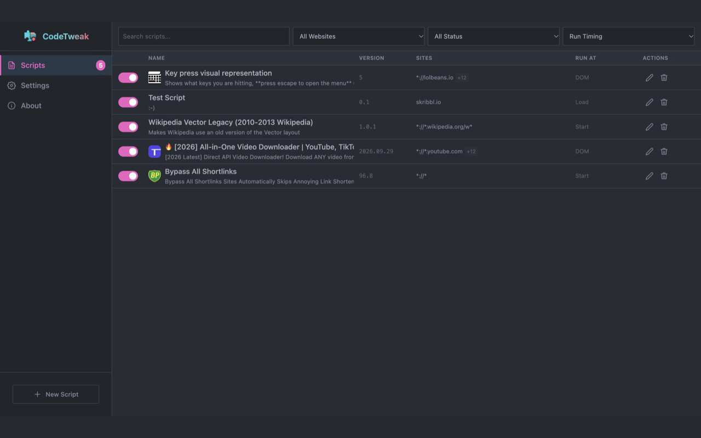

# Dashboard and settings

The dashboard is where you manage all of your scripts and CodeTweak's settings. Open it from the grid button in the popup.

## Scripts

Every installed script is listed with its version, the sites it runs on, and its run timing (**Start**, **DOM**, or **Load**; see [Run timing](/reference/run-timing)).

- **Switch:** turns the script on or off.
- **Pencil:** opens the script in the [editor](/guide/editor).
- **Circular arrows:** appears when an update is waiting for your review. See [Reviewing updates](/guide/greasyfork#reviewing-an-update).
- **Database:** appears for scripts that save data with the [storage APIs](/reference/gm-apis/storage). Click it to delete everything the script has saved, for example to reset its settings. Reload any open pages afterwards.
- **Trash can:** deletes the script, along with its saved data, version history, and error log, after asking you to confirm.

Use the search box and the filters at the top to narrow the list by name, website, status (enabled or disabled), or run timing.

Click **New Script** in the sidebar to open an empty script in the editor.

### Import scripts from files

Drag one or more `.js` or `.txt` userscript files from your computer onto the dashboard. CodeTweak reads each file's metadata block and adds the scripts, enabled.

### Export all

**Settings → Export All** downloads every script as a `.user.js` file into a `CodeTweak Export` folder in your downloads. Use it to back up your scripts or move them to another browser. To restore them, drag the files back onto the dashboard.

Export saves script code only. Values that scripts stored with `GM_setValue` aren't included.

## Settings

Open **Settings** in the sidebar. Click **Save Settings** after making changes, or **Reset Defaults** to go back to the original values.

### General

| Setting                       | Default | What it does                                                                                                                                                                                                            |
| ----------------------------- | ------- | ----------------------------------------------------------------------------------------------------------------------------------------------------------------------------------------------------------------------- |
| **Enable scripts by default** | On      | New scripts, including ones you install or import, are switched on as soon as you save them. Turn it off to have them start switched off, so you can review them first. Editing a script never changes whether it's on. |
| **Show notifications**        | On      | Allows desktop notifications from scripts (`GM_notification`) and from CodeTweak. Turn it off to silence all of them.                                                                                                   |
| **Enhanced Debugging**        | Off     | Records errors from your scripts in the editor's **Script Errors** panel. See [Script errors](/guide/editor#script-errors).                                                                                             |
| **Language**                  | Auto    | The language of CodeTweak's interface: your browser's language, English, Spanish, or French.                                                                                                                            |

### Security

| Setting                      | Default | What it does                                                                                                                                         |
| ---------------------------- | ------- | ---------------------------------------------------------------------------------------------------------------------------------------------------- |
| **Allow external resources** | On      | Lets scripts make requests to other websites with `GM_xmlhttpRequest`. Turn it off to block all of those requests.                                   |
| **Confirm first run**        | Off     | Shows a one-time notification the first time each script runs, so you know when a new script becomes active. **Show notifications** must also be on. |

### Theme

Pick an **Accent Color** for buttons, switches, and the toolbar badge.

### Storage

The settings page shows how much browser storage CodeTweak is using. If storage is nearly full, a warning appears here. Delete scripts you no longer use, or clear the saved data of scripts that store a lot, to free space.

## About

**About** links to this documentation and the [privacy policy](/guide/privacy).
