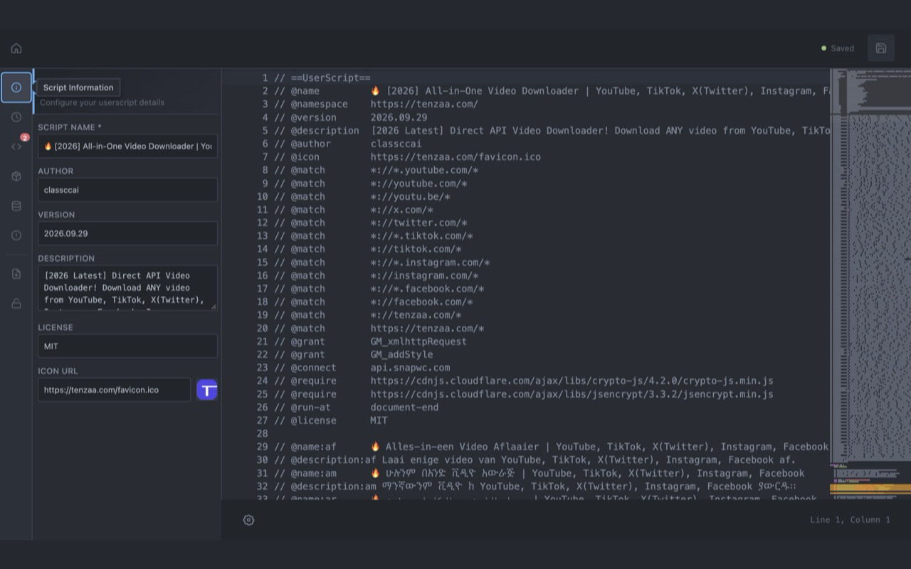
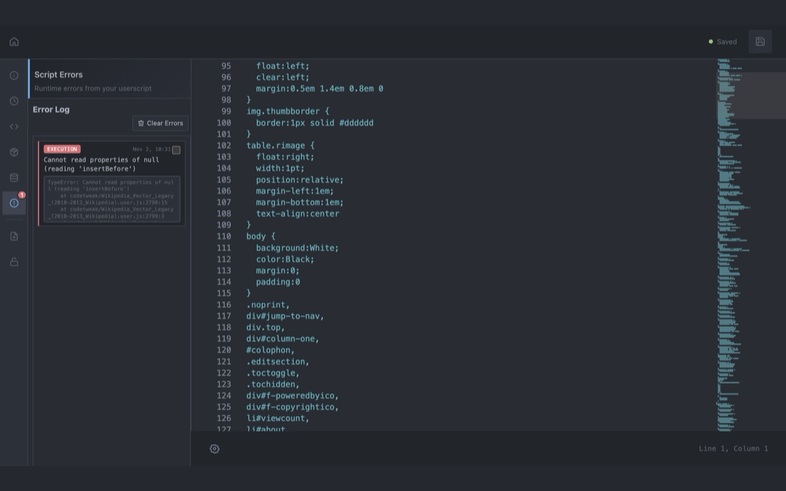

# Script editor

The editor is where you write and configure scripts. Open it by clicking **+** in the popup, **New Script** in the dashboard, or the pencil next to any script.

## Layout

- **Top bar:** the home button returns to the dashboard. On the right are the save status (**Saved** or **Unsaved**) and the save button.
- **Code area:** your script, with syntax highlighting, autocomplete for the GM APIs, bracket matching, and a minimap.
- **Sidebar:** a column of icons on the left. Each opens a panel; hover over an icon to see its name.
- **Bottom bar:** the gear opens [editor settings](#editor-settings), and the cursor position is shown on the right.

## Sidebar panels

The panels give you form fields for the metadata block, so you don't have to remember the syntax. Changes in a panel update the code, and edits to the metadata block in the code update the panels.

### Script Information

Name, author, version, description, license, and icon. The icon can be a web address or a `data:image/...` URL, and appears in the popup and dashboard.

### Execution Settings

- **Target URLs:** the pages the script runs on. Type a pattern and click **Add**, or use the **Pattern Builder**: enter an address, choose a scope, then click **Generate** and **Insert**. See [Choosing sites](/reference/match-patterns).

  | Scope                  | From `https://shop.example.com/cart?id=4` | Runs on                                      |
  | ---------------------- | ----------------------------------------- | -------------------------------------------- |
  | **Any path on domain** | `https://shop.example.com/*`              | Every page on that host.                     |
  | **Any sub-domain**     | `https://*.example.com/*`                 | Every page on the domain and its subdomains. |
  | **Exact page**         | `https://shop.example.com/cart?id=4`      | Only that exact address.                     |

- **Run Timing:** **Document Start**, **DOM Loaded**, or **Page Loaded**. See [Run timing](/reference/run-timing).
- **Execution Context:** **Default**, **Isolated World**, or **Main World**. Leave this on **Default** unless you know you need another option. See [Where scripts run](/reference/gm-apis/advanced#where-scripts-run).

### GM API Access

Tick the GM APIs your script uses. Each one adds a `@grant` line to the metadata block. Use the search box to find an API by name. The badge on the icon shows how many are selected.

### Required Scripts

Libraries to load before your script, such as jQuery. Each one adds a `@require` line. Only `https://` addresses are allowed.

### Script Resources

Files your script can read with [`GM_getResourceText`](/reference/gm-apis/resources#gm-getresourcetext) and [`GM_getResourceURL`](/reference/gm-apis/resources#gm-getresourceurl). Give each a name and an address. Each one adds a `@resource` line.

### Script Errors

Errors from your script, with the time, the message, and where it happened. The badge on the icon shows how many there are. Click **Clear Errors** to empty the list.

This panel only collects errors while **Enhanced Debugging** is on in the [dashboard settings](/guide/dashboard#general). It records:

- errors thrown while the script starts, including a rejected promise from its top level;
- `@require` or `@resource` files that failed to download.

Errors thrown later, from timers or event handlers, appear in the page's DevTools console instead (press <kbd>F12</kbd>).

### Version History

CodeTweak saves a snapshot of a script just before each save overwrites it, and before an approved update replaces it. The last 20 snapshots are kept per script.

Click **Restore** on a snapshot to load it into the editor. Nothing changes until you save, so you can look at an old version without losing the current one. Click **Delete** to remove a snapshot, or **Clear History** to remove them all.

## Tools

Two buttons sit below the panel icons in the sidebar:

- **Generate Metadata header:** writes a metadata block from the values in the panels. Useful when you started with plain code.
- **Deobfuscate JavaScript:** tries to turn minified or obfuscated code back into readable code. Check the result before saving, because it rewrites the code area.

## Saving

Press <kbd>Ctrl</kbd>+<kbd>S</kbd> (<kbd>Cmd</kbd>+<kbd>S</kbd> on Mac) or click the save button. Saved changes apply to pages the next time they load, so reload any open tabs to see them.

Turn on **Enable Autosave** in the editor settings to save automatically shortly after you stop typing.

## Editor settings

Click the gear in the bottom bar to change:

- font size and tab size;
- **Show Line Numbers**, **Line Wrapping**, **Match Brackets**, and **Show Minimap**;
- **Enable Linting**, which underlines likely mistakes in your code;
- **Enable Autosave**.

## Keyboard shortcuts

| Action           | Windows / Linux                  | Mac                              |
| ---------------- | -------------------------------- | -------------------------------- |
| Save             | <kbd>Ctrl</kbd>+<kbd>S</kbd>     | <kbd>Cmd</kbd>+<kbd>S</kbd>      |
| Autocomplete     | <kbd>Ctrl</kbd>+<kbd>Space</kbd> | <kbd>Ctrl</kbd>+<kbd>Space</kbd> |
| Toggle comment   | <kbd>Ctrl</kbd>+<kbd>/</kbd>     | <kbd>Cmd</kbd>+<kbd>/</kbd>      |
| Toggle minimap   | <kbd>Ctrl</kbd>+<kbd>M</kbd>     | <kbd>Ctrl</kbd>+<kbd>M</kbd>     |
| Full screen      | <kbd>F11</kbd>                   | <kbd>F11</kbd>                   |
| Exit full screen | <kbd>Esc</kbd>                   | <kbd>Esc</kbd>                   |

On a Mac, the minimap shortcut uses <kbd>Ctrl</kbd>, because <kbd>Cmd</kbd>+<kbd>M</kbd> minimizes the window.

**Help & Shortcuts**, at the bottom of the editor settings window, shows these shortcuts and a quick reference for URL patterns.
