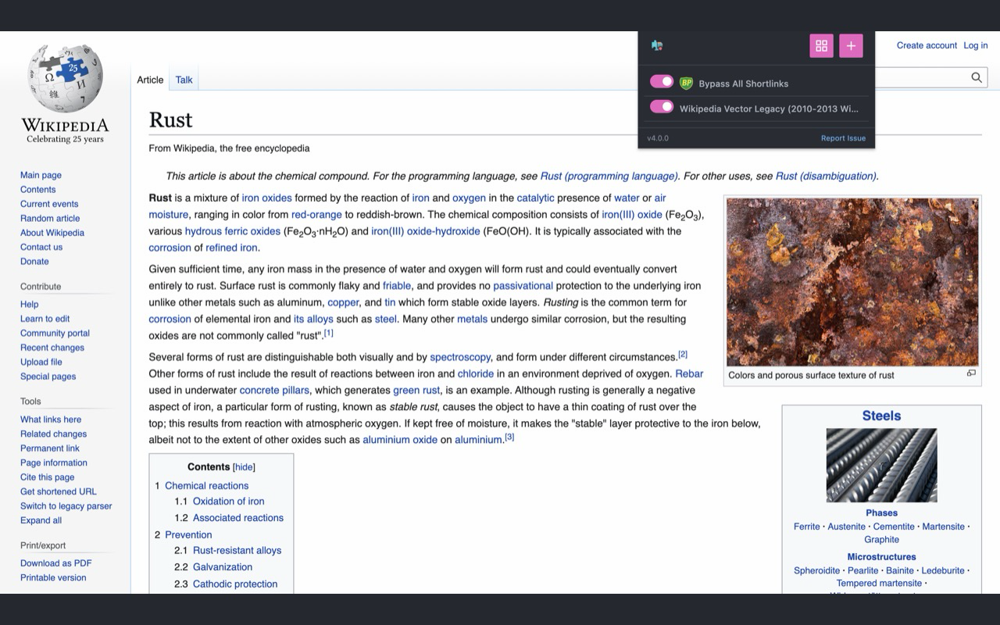

# Your first script

This walkthrough takes about two minutes. You'll write a small script that changes a web page, then see it run.

Before you start, [install CodeTweak](/guide/installation) and make sure user scripts are allowed.

## 1. Open the editor on the site you want to change

1. Go to `https://example.com`.
2. Click the CodeTweak icon in your toolbar.
3. Click the **+** button at the top of the popup.

The editor opens in a new tab. Because you started from example.com, the script is already set to run on that site.

## 2. Write the script

Replace everything in the code area with:

```javascript
// ==UserScript==
// @name        Hello CodeTweak
// @match       https://example.com/*
// @run-at      document-end
// @grant       none
// ==/UserScript==

document.querySelector('h1').textContent = 'Hello from CodeTweak!';
document.body.style.background = '#fef6d8';
```

The block of `//` comments at the top is the **metadata block**. It tells CodeTweak the script's name, which sites it runs on (`@match`), and when it runs (`@run-at`). See [Userscript basics](/guide/writing-userscripts) for every option.

## 3. Save

Click the save button in the top-right corner, or press <kbd>Ctrl</kbd>+<kbd>S</kbd> (<kbd>Cmd</kbd>+<kbd>S</kbd> on Mac). The status changes from **Unsaved** to **Saved**.

## 4. See it run

Reload the example.com tab. The heading now says **Hello from CodeTweak!** and the background is yellow.

Open the CodeTweak popup on that page. Your script is listed with a switch to turn it off and on.



## If nothing changed

- Look for a red **User scripts are disabled** banner in the popup. If you see one, follow the steps in [Install CodeTweak](/guide/installation).
- Make sure you reloaded the page after saving. Scripts run when a page loads.
- Check that the address matches `@match`. For example, `https://example.com/*` doesn't match `https://www.example.com/`.

More fixes are in [Troubleshooting](/troubleshooting/common-issues).

## Next steps

- [Install ready-made scripts from Greasy Fork](/guide/greasyfork)
- [Tour the script editor](/guide/editor)
- [Learn the metadata block](/guide/writing-userscripts)
- [Store data and make requests with the GM APIs](/reference/gm-apis)
