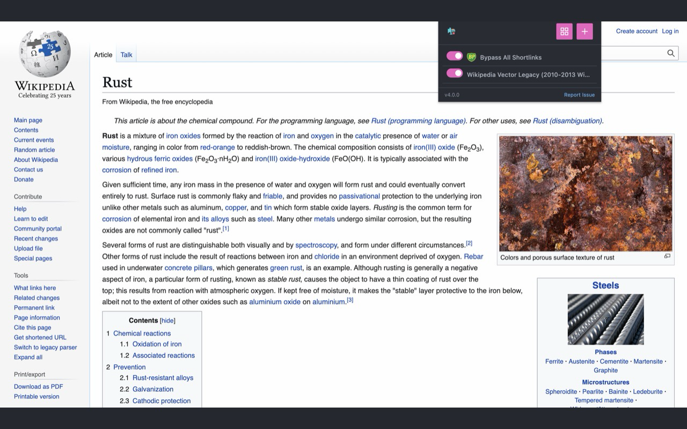

# Popup and element picker

## The popup

Click the CodeTweak icon in your toolbar to open the popup. It shows what CodeTweak is doing on the page you're viewing.

- **Script list:** every enabled or disabled script whose sites match the current page. Use the switch to turn a script on or off, and click a script's name to open it in the editor. Changes take effect the next time the page loads.
- **Grid button:** opens the [dashboard](/guide/dashboard).
- **+ button:** creates a new script that targets the current site.
- **Menu Commands:** buttons added by scripts running on this page (see below).
- **Report Issue:** opens a new issue on GitHub.

The number on the toolbar icon is how many of your scripts match the current page.

::: info Pages where scripts can't run
Browsers don't let extensions run scripts on their own pages (such as `chrome://` and `about:` pages), on the Chrome Web Store, or on Firefox Add-ons. The popup has nothing to show on those pages.
:::

### Menu commands

Scripts can add their own actions to the popup with [`GM_registerMenuCommand`](/reference/gm-apis/ui#gm-registermenucommand), such as "Open settings" or "Export data". They appear under **Menu Commands** while the script is running on the page. Click one to run it.

If a script's commands are missing, reload the page. Commands are registered when the script runs, so they won't appear for pages that were open before you installed or enabled the script.

## Element picker

The element picker writes simple scripts for you by pointing at part of a page.

1. Right-click anywhere on a page and choose **Select Element for Script**.
2. Move the mouse over the page. The element under the cursor is highlighted.
3. Click the element you want.
4. Choose an action:

| Action             | What happens                                                                |
| ------------------ | --------------------------------------------------------------------------- |
| **Copy Selector**  | Nothing is created. The element's CSS selector is copied to your clipboard. |
| **Hide Element**   | Hides the element every time the page loads.                                |
| **Remove Element** | Removes the element from the page.                                          |
| **Click Element**  | Clicks the element automatically.                                           |
| **Watch Changes**  | Logs changes to the element in the DevTools console.                        |

For every action except **Copy Selector**, a new script opens in the editor with the generated code, set to run on every page of the current site. Nothing changes until you save it, so you can review the code, narrow or widen the target URL, or combine it with other code first. Your existing scripts are never changed.

Press <kbd>Esc</kbd> at any time to cancel.
